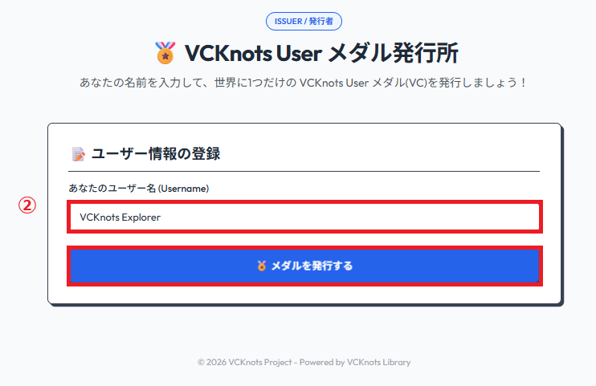
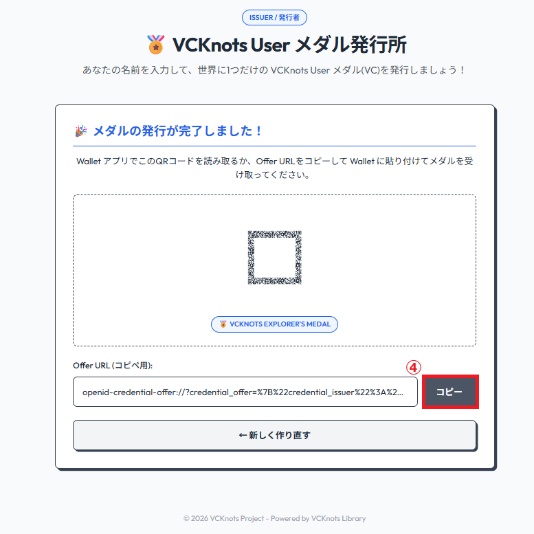
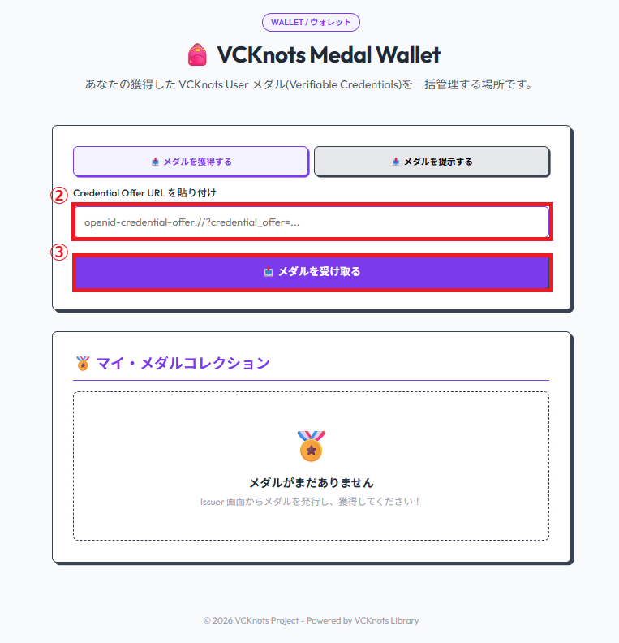
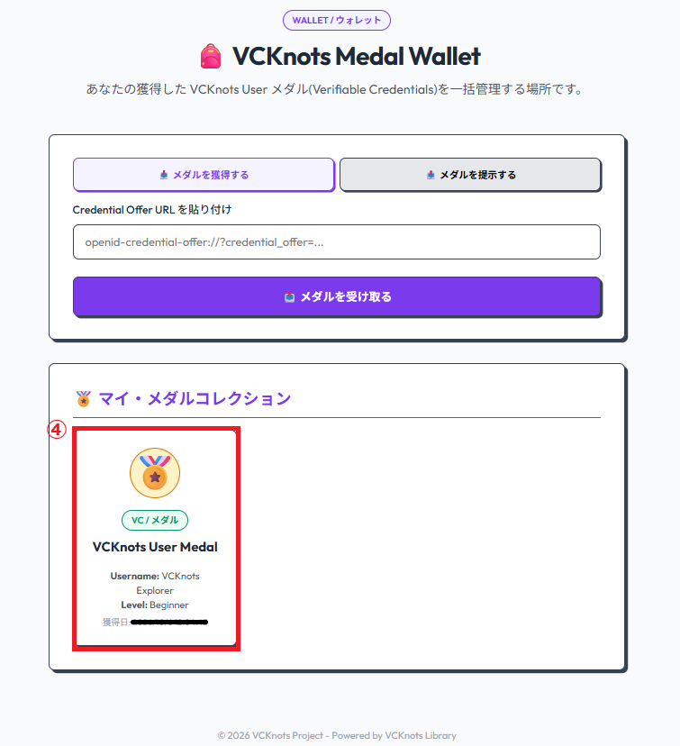
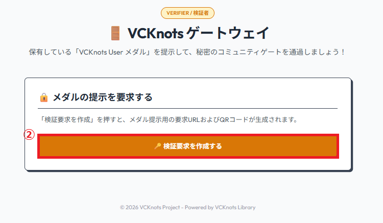
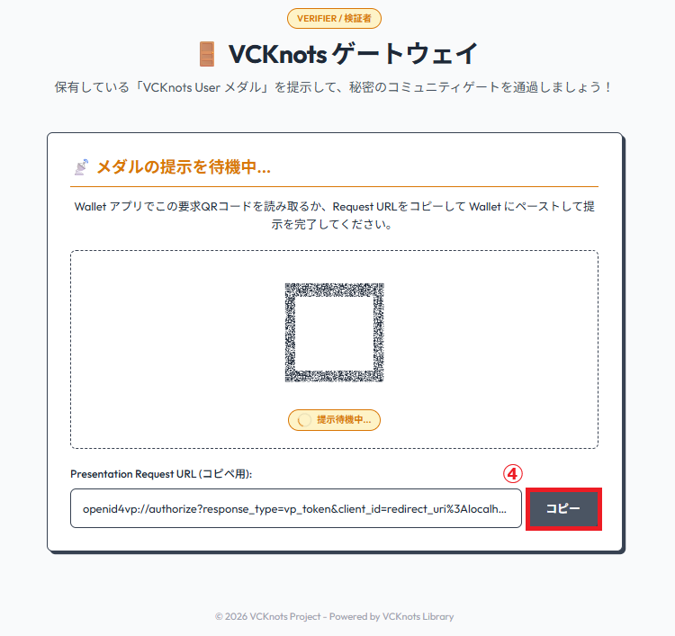
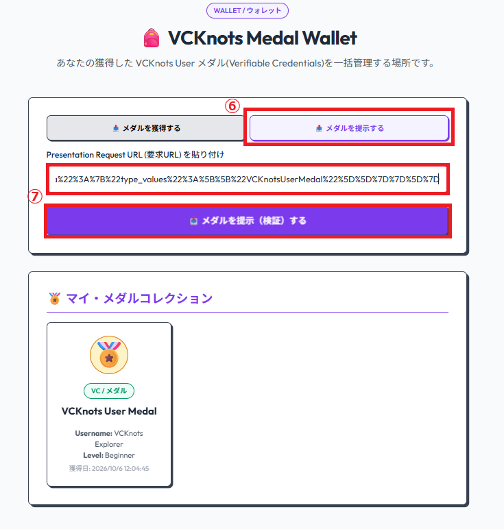
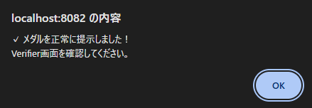
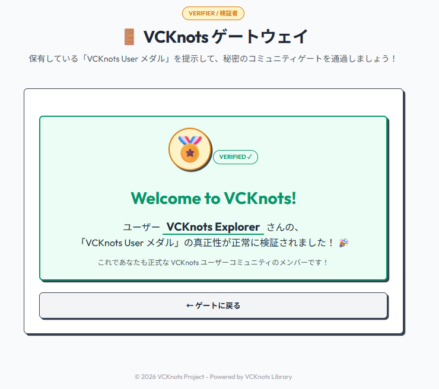

# hello-vcknots: VC Knots E2E VC発行・検証サンプルアプリ 🏅

`hello-vcknots` は、ローカル環境で **Issuer（発行者）**、**Wallet（保持者）**、**Verifier（検証者）** の3つの役割をすべて起動させ、E2EでVerifiable Credential (VC) の発行から検証までの流れを体験できるサンプルアプリケーションです。

VC Knots の「Hello World」として、新しく VC Knots の世界に足を踏み入れた新規ユーザーの門出を祝う **「VC Knots User メダル」** という VC を配布し、それを検証してコミュニティへ歓迎する、というストーリーをベースにしています。

ライトテーマと親しみやすいすっきりとした境界線を用いた「フラットデザイン（Flat Design）」を採用しています。

---

## 🏗 アプリケーション構成

- **Issuer サーバー (TypeScript / Hono)**
  - ポート: `http://localhost:8080`
  - 役割: ユーザー名から「VC Knots User メダル」を発行する（OpenID4VCI）。
  - UI 画面: `http://localhost:8080/issuer.html`
- **Verifier サーバー (TypeScript / Hono)**
  - ポート: `http://localhost:8081`
  - 役割: 提示されたメダルを検証して歓迎メッセージを表示する（OpenID4VP & ポーリング）。
  - UI 画面: `http://localhost:8081/verifier.html`
- **Wallet サーバー & Web UI (Go)**
  - ポート: `http://localhost:8082`
  - 役割: メダルを獲得・保管し、検証者へ提示する。
  - UI 画面: `http://localhost:8082` (マイ・メダルホルダー)

---

## 🚀 ローカル起動手順

本リポジトリのルートで以下のコマンドを実行するだけで、すべてのサーバーを一括で並行起動できます。

### 1. 環境変数ファイルの準備

Issuer/Verifier サーバーのポート設定に `.env` ファイルが必要です。`.env.example` をコピーして作成します。

```bash
# macOS / Linux
cp issuer-verifier/.env.example issuer-verifier/.env

# Windows
copy issuer-verifier\.env.example issuer-verifier\.env
```

デフォルト設定（Issuer: 8080 / Verifier: 8081）のままで動作します。変更が必要な場合は `.env` を編集してください。

### 2. 依存関係のインストールと準備

リポジトリのルートディレクトリで以下を実行します。

```bash
pnpm install
pnpm build
```

### 3. アプリケーションの同時起動

以下のコマンドを実行すると、Issuer/Verifier サーバーと Go製 Wallet サーバーが同時に起動します。

```bash
pnpm dev
```

起動が完了すると、コンソールに以下のように表示されます：

```
hello-vcknots Issuer Server is running!
Issuer Web UI  : http://localhost:8080/issuer.html

hello-vcknots Verifier Server is running!
Verifier Web UI: http://localhost:8081/verifier.html

hello-vcknots Go Wallet Server is running!
Wallet Web UI: http://localhost:8082
```

---

## 🏅 E2E 体験シナリオ (体験手順)

起動後、ブラウザで以下の3つのタブ（またはウィンドウ）を開いて、ストーリーに沿って操作します。

1. **Issuer 画面**: `http://localhost:8080/issuer.html`
2. **Verifier 画面**: `http://localhost:8081/verifier.html`
3. **Wallet 画面**: `http://localhost:8082`

### ステップ 1: メダル(VC)の発行（OpenID4VCI）

1. **Issuer 画面** (`http://localhost:8080/issuer.html`) を開きます。
2. **「Your Username」** 欄にお好きなユーザー名（例: `Taro`）を入力し、**「🏅 メダルを発行する」** ボタンをクリックします。



3. 画面に「VC Knots User Medal」のゴールドメダルイラスト 🏅、および **Credential Offer URL** とQRコードが表示されます。
4. **「コピー」** ボタンを押して、生成された URL をクリップボードにコピーします。



### ステップ 2: メダルの獲得と保管（Wallet）

1. **Wallet 画面** (`http://localhost:8082`) を開きます。
2. アクションエリアの **「メダルを獲得する」** タブ（初期選択）にある入力欄に、コピーした **Offer URL** をペーストします。
3. **「メダルを受け取る」** ボタンをクリックします。



4. OpenID4VCI プロトコルによる通信が行われ、数秒後に **「My Medals（保有メダル）」** グリッドに、美しいフラットデザインの **「🏅 VC Knots User Medal」** カードが追加されます！
5. カード内の **「Username」** が Issuer で入力した名前になっていること、および発行日やステータスが正しく描画されていることを確認します。



### ステップ 3: メダルの提示と検証（OpenID4VP）

1. **Verifier 画面** (`http://localhost:8081/verifier.html`) を開きます。
2. 画面の **「検証要求を作成する」** ボタンをクリックします。



3. 画面上に OpenID4VP の **Presentation Request URL** とQRコードが表示され、自動的にステータス監視（ポーリング）が開始されます。
4. **「コピー」** ボタンを押して、生成された URL をクリップボードにコピーします。



5. **Wallet 画面** (`http://localhost:8082`) に戻ります。
6. アクションエリアの **「メダルを提示する」** タブに切り替えます。
7. 入力欄に、コピーした **Request URL** をペーストし、**「メダルを提示（検証）する」** ボタンをクリックします。



8. 提示が成功すると、Wallet 側で「提示に成功しました！」と表示されます。



9. **Verifier 画面** に戻ると、ポーリングによって提示された VC をリアルタイムで検証・検知し、自動的に **歓迎画面（Welcome to VC Knots!）** に切り替わります！🎉
10. 歓迎カードに、あなたがメダル獲得時に入力したユーザー名（例: `Welcome to VC Knots, Taro! 🏅`）が大きなフラットバナーで表示され、メダルの署名の真正性や検証時間が美しくフラットに表示されていることを確認してください。



---

## 🎨 デザインのこだわり（Flat Design）

本アプリは、単色（ソリッドカラー）の塗りと明快な境界線、およびハードシャドウを組み合わせた **「フラット・レトロモダン」** なスタイルを採用しています。
- グラデーションやボカシ（blur）を使わず、白・グレーを基調に、はっきりとした黒枠線 (`border: 2px solid #1f2937`) と、少しズレた影 (`box-shadow: 4px 4px 0px 0px #1f2937`) で構成された、親しみやすくメリハリのあるビジュアルです。
- スマートフォンや PC からでも、ボタンの押しやすさやカードの可読性に配慮したレスポンシブな設計になっています。
